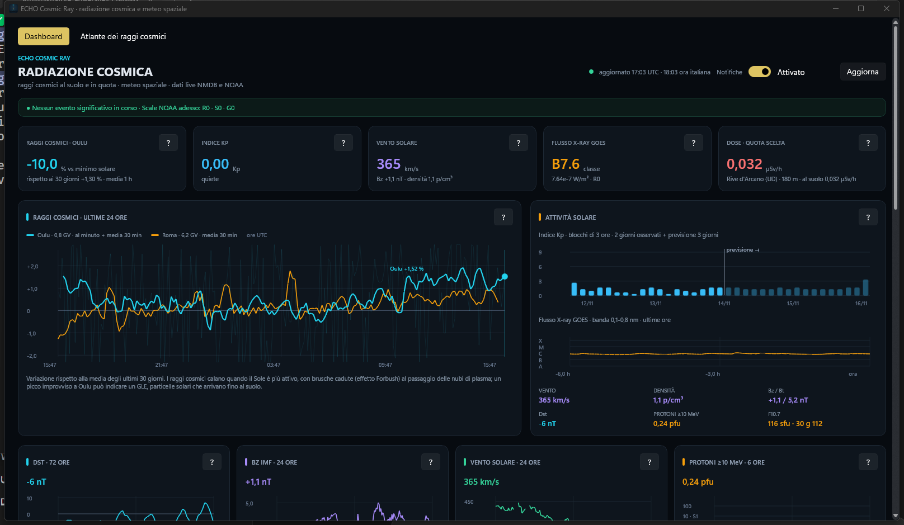
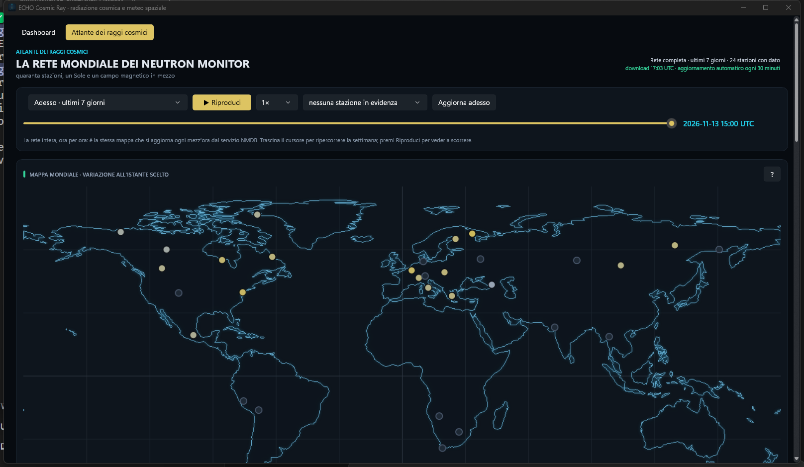
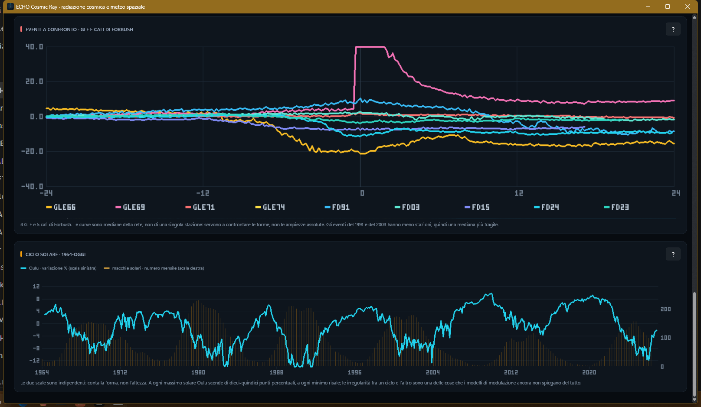

# ECHO Cosmic Ray

**Dashboard desktop per la radiazione cosmica e il meteo spaziale.** Raccoglie i
dati pubblici dei neutron monitor della rete NMDB e di NOAA SWPC, li elabora e li
mostra in tempo quasi reale, con un atlante della rete mondiale e la riproduzione
degli eventi storici.

*Windows desktop dashboard for cosmic-ray and space-weather monitoring: NMDB
neutron monitors, GOES particles, solar wind, geomagnetic indices and a world
atlas of historical GLE and Forbush events. Rust + WinUI.*




## Perché esiste

La radiazione cosmica al suolo è un termometro del Sole e del campo magnetico
terrestre. Quando il Sole si calma, i raggi cosmici aumentano; quando una nube di
plasma colpisce la magnetosfera, calano di colpo (effetto Forbush); quando un
brillamento accelera protoni fino a GeV, le stazioni polari registrano un picco
(GLE). Questi dati sono pubblici ma sparsi, in formati diversi e poco leggibili.
L'app li mette insieme in una finestra sola, con la stessa scala e lo stesso
orologio.

## La dashboard

- **Oulu e Roma al minuto**, con la variazione rispetto al minimo solare e alle
  ultime 24 ore; 30 giorni di medie orarie a confronto.
- **Meteo spaziale**: Kp stimato e previsione a 3 giorni, X-ray GOES, protoni
  ≥10 MeV, vento solare, densità, Bz/Bt, Dst, F10.7, scale NOAA R/S/G e ultimi
  bollettini SWPC.
- **Profilo di dose per quota** (0–40 km) per la località scelta, confrontato con
  una zona polare e una equatoriale.
- **Mappa mondiale** dell'intensità al suolo con taglio di Störmer da dipolo
  inclinato.
- **Avvisi di Windows** con isteresi: tempeste G, tempeste di radiazione S,
  brillamenti R, cali di Forbush, possibili GLE, Bz fortemente negativo.
- **Storico orario in CSV** apribile con Excel (separatore `;`, virgola decimale).

## L'atlante dei raggi cosmici

Una seconda pagina dedicata alla rete mondiale dei neutron monitor: **42 stazioni
NMDB**, con coordinate, quota e rigidità di taglio.



- **Mappa animata**: ogni punto è una stazione, colorata secondo la variazione
  percentuale dei conteggi. Il cursore scorre la settimana (o i 3 giorni
  dell'evento) e la riproduzione automatica va da 0,5× a 4×.
- **Eventi storici riproducibili**: GLE 66 (ottobre 2003), GLE 69 (gennaio 2005),
  GLE 71 (maggio 2012), GLE 74 (maggio 2024) e i cali di Forbush del giugno 1991,
  novembre 2003, giugno 2015, maggio 2024 e aprile 2023.
- **Heatmap stazioni × tempo**: 42 righe ordinate per rigidità, una colonna per
  passo. Si vede il fronte dell'evento scendere dalle stazioni polari a quelle
  equatoriali, e si vedono i buchi della rete.
- **Spettro di rigidità**: Δ% contro Rc in scala logaritmica, con il fit
  `Δ% = a − γ·ln(Rc)`. Nei GLE la risposta crolla alle alte rigidità (γ grande);
  nei Forbush resta piatta.
- **Eventi a confronto**: i nove eventi sovrapposti come mediana della rete e
  allineati al picco. I GLE sono picchi stretti, i Forbush depressioni larghe.
- **Piccoli multipli**: una curva per stazione, ordinate per rigidità di taglio
  crescente; un clic evidenzia la stazione sulla mappa.
- **Ciclo solare dal 1964**: variazione mensile di Oulu contro il numero di
  macchie solari SILSO.



## Installazione

L'eseguibile è autosufficiente: mappa, loghi, eventi storici e istantanea della
rete sono incorporati. Non serve installare nulla.

1. scarica `ECHO-Cosmic-Ray-0.3.0.zip` dalle release (o prendi
   `dist\Radiazione Cosmica.exe` dal repository);
2. aprilo. Al primo avvio la dashboard scarica i dati; senza rete mostra quello
   che ha già dentro.

I dati raccolti finiscono in `%APPDATA%\ECHO Cosmic Ray\` (pulsante **Cartella
dati** in fondo alla finestra):

| File | Contenuto |
|---|---|
| `impostazioni.txt` | località, quota, notifiche attive/spente |
| `storico_orario.csv` | una riga per ora: Oulu/Roma, % dal minimo solare, Kp max, X-ray max, protoni max, vento, Bz min, Dst |

## Build

```powershell
cargo test --release
cargo build --release
```

Serve Rust stabile su Windows (edition 2021). L'exe esce in `target\release` e
funziona da solo. L'icona e i metadati di versione sono incorporati da `build.rs`
(`winresource`).

## Architettura

```text
cosmic-ray-dashboard/
├─ src/
│  ├─ main.rs        # componente, pagine, messaggi, ciclo di aggiornamento
│  ├─ api.rs         # fonti, cadenze, download in parallelo, parsing
│  ├─ state.rs       # serie unite, modulazione, Forbush, GLE
│  ├─ alerts.rs      # eventi con isteresi, notifiche, storico CSV
│  ├─ charts.rs      # grafici della dashboard
│  ├─ model.rs       # modello fisico, località, scale NOAA, mappa
│  ├─ atlas.rs       # stazioni, formato binario, eventi, serie solare
│  ├─ atlas_draw.rs  # bitmap: piccoli multipli, heatmap, spettro, eventi
│  └─ atlas_ui.rs    # pagina Atlante: stato, mappa, pannelli
├─ assets/           # icona, mappa, loghi, dati dell'atlante (assets/atlas)
├─ tools/            # pipeline dati (atlas_build.py), icona, mappa
├─ docs/             # screenshot
├─ build.rs
└─ Cargo.toml
```

Scelte tecniche che valgono la pena di essere dette:

- **Bitmap disegnate a mano** (canvas RGB + font 3×5) per i grafici densi:
  centinaia di linee ridisegnate a ogni fotogramma non reggono, una bitmap sì.
- **Formato binario compatto `NMDA`** per gli eventi: intestazione con stazione,
  passo e istante iniziale, poi `f32` riga per riga, `NaN` per i buchi. Nove
  eventi e l'istantanea della rete stanno in pochi megabyte dentro l'exe.
- **Finestre evento da 3 giorni a 10 minuti**, base = mediana delle prime 6 ore.
- **Download parallelo con cadenze indipendenti**: una fonte lenta non blocca le
  altre, e una fonte che fallisce riprova dopo 2 minuti.

## Dati, cadenze, rete

| Fonte | Dato | Cadenza |
|---|---|---|
| NMDB | Oulu e Roma al minuto | 2 min |
| NMDB | medie orarie 30 giorni | 1 h |
| NMDB | rete completa per l'atlante | 30 min |
| NOAA SWPC | Kp, vento solare, IMF | 2 min |
| NOAA SWPC | X-ray GOES, protoni | 3–5 min |
| NOAA SWPC | scale, bollettini, Dst, F10.7 | 10 min – 6 h |
| SILSO | macchie solari mensili | incluso negli asset |

NMDB non è raggiungibile da tutte le reti. Le richieste passano quindi da un
piccolo **Cloudflare Worker** che inoltra solo `/nest/draw_graph.php`, estrae la
tabella ASCII e la tiene in cache 60 secondi; se non risponde, l'app prova la
connessione diretta e poi un reader pubblico.

Poiché NMDB conserva solo 7 giorni, un secondo Worker salva **ogni ora** le
misure delle 42 stazioni in un bucket R2 dedicato (`rete/AAAA/MM/GG/HH.json`,
lettura con `GET /archive?giorno=AAAA-MM-GG`). L'archivio cresce da solo e
servirà a estendere la finestra dell'atlante oltre la settimana.

## Metodo e limiti

- **Riferimenti fissi**: Oulu, minimo solare 114,07 conteggi/s (dicembre 2009);
  Roma, 129,16 (dicembre 2020). Per Roma si usano solo i dati dopo il salto
  strumentale dell'agosto 2017.
- **Dose**: ancore UNSCEAR/ICRU per Rc ≈ 5 GV, interpolazione log-lineare,
  effetto della latitudine crescente con la quota. **Non è una misura
  dosimetrica.**
- **Mappa**: taglio di Störmer da dipolo inclinato; non include le anomalie
  locali del campo (per esempio l'Atlantico meridionale).
- Le variazioni si calcolano su medie a 30–60 minuti: il dato al minuto è
  rumoroso (circa ±1,5%).
- La copertura storica è disomogenea: nel 1991 la rete era molto più piccola.
  Dove i dati mancano, l'app lo dice invece di interpolare.

## Ringraziamenti

Un grazie a chi misura, conserva e condivide questi dati:

- **NMDB** ([www.nmdb.eu](https://www.nmdb.eu)) — rete dei neutron monitor
- **Università di Oulu, Osservatorio di Sodankylä** ([cosmicrays.oulu.fi](https://cosmicrays.oulu.fi)) — neutron monitor di Oulu
- **Osservatorio SVIRCO, INAF-IAPS, Università Roma Tre** — neutron monitor di Roma
- **NOAA SWPC** ([swpc.noaa.gov](https://www.swpc.noaa.gov)) — Kp, GOES, vento solare, F10.7, scale, bollettini
- **WDC for Geomagnetism, Kyoto** ([wdc.kugi.kyoto-u.ac.jp](https://wdc.kugi.kyoto-u.ac.jp)) — indice Dst
- **SILSO, Royal Observatory of Belgium** ([sidc.be/silso](https://www.sidc.be/silso/)) — numero mensile di macchie solari
- **Natural Earth** ([naturalearthdata.com](https://www.naturalearthdata.com)) — linee di costa, dominio pubblico

Riconoscimento richiesto da NMDB:

> We acknowledge the NMDB database (www.nmdb.eu), founded under the European
> Union's FP7 programme (contract no. 213007), and the PIs of individual neutron
> monitors at: Oulu (Sodankylä Geophysical Observatory of the University of Oulu,
> Finland) and Rome (SVIRCO Observatory, INAF/IFSI-UniRomaTre, Italy) for
> providing data.

ECHO Cosmic Ray è un progetto personale, non affiliato né approvato dagli enti
citati. I loghi servono solo a riconoscere la provenienza dei dati.

## Avvertenze

- I dati vengono da servizi pubblici: disponibilità, latenza e formato possono
  cambiare senza preavviso.
- Le informazioni hanno scopo informativo e divulgativo. Per valutazioni
  operative, sanitarie o di radioprotezione servono fonti e strumenti
  certificati.

## Copyright

Copyright (c) 2026 **PIGNOLO GIMMY**. Tutti i diritti riservati.
